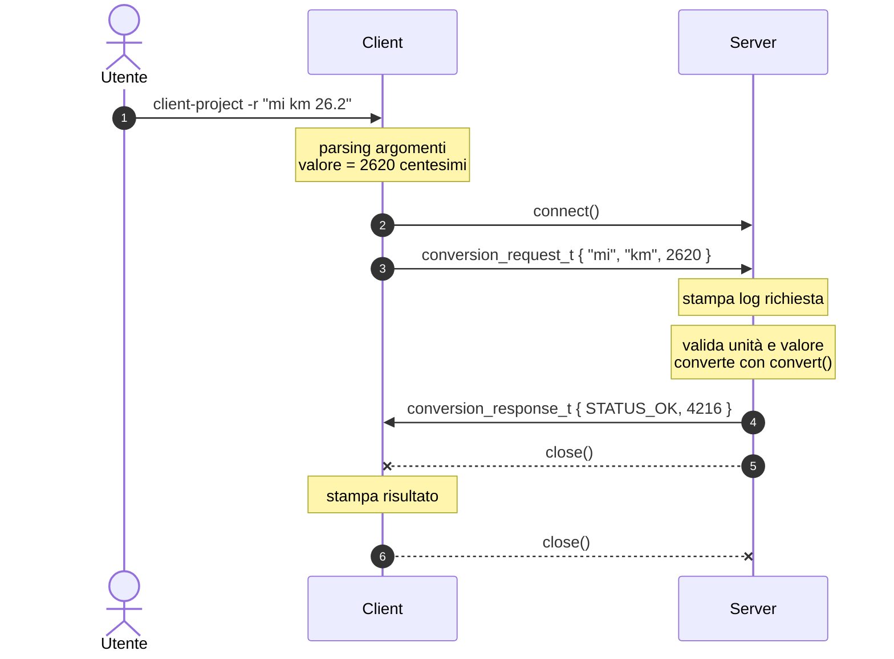

# Primo Esonero di Laboratorio - Reti di Calcolatori (Informatica) a.a. '26-27

## Obiettivo

Implementare un'applicazione TCP client/server in cui il server è un **convertitore di unità di misura**.

La specifica è data da tre elementi, da leggere insieme:

1. il file [`protocol.h`](client-project/src/protocol.h) (già fornito, **non modificare** le definizioni);
2. il diagramma di sequenza;
3. la tabella degli esempi, che fa fede per il formato di input e output.

## 1. Protocollo

Le strutture `conversion_request_t` e `conversion_response_t`, i codici di stato e le costanti sono definiti in [`protocol.h`](client-project/src/protocol.h). Client e server si scambiano queste strutture rispettando tre regole:

- i valori sono espressi **in centesimi** (es. `26.2` → `2620`);
- i campi `uint32_t` vanno convertiti in **network byte order** prima dell'invio (`htonl()`) e riconvertiti dopo la ricezione (`ntohl()`);
- in caso di errore (`status != STATUS_OK`) il server invia `value = 0`.

## 2. Diagramma di sequenza



Il server serve un client alla volta e non termina mai.

## 3. Unità di misura e conversione (server)

Per ogni unità, la tabella riporta la grandezza e il valore di 1 unità nell'unità base della grandezza (micrometri per le lunghezze, microgrammi per le masse). Il server deve usare **esattamente** questa tabella e questa funzione:

```c
typedef enum { LENGTH, MASS } quantity_t;

typedef struct {
    const char *symbol;
    quantity_t quantity;
    uint32_t factor;   // 1 unit in the base unit: micrometres (LENGTH), micrograms (MASS)
} unit_t;

static const unit_t UNITS[] = {
    {"m",  LENGTH,    1000000}, {"km", LENGTH, 1000000000}, {"ft", LENGTH, 304800},
    {"yd", LENGTH,     914400}, {"mi", LENGTH, 1609344000},
    {"g",  MASS,      1000000}, {"kg", MASS,   1000000000}, {"oz", MASS,   28349523},
    {"lb", MASS,    453592370},
};

/*
 * Converts a value in hundredths from one unit to another of the same quantity,
 * rounding to the nearest hundredth.
 * Example: 26.20 mi -> km is convert(2620, 1609344000, 1000000000) = 4216 (42.16 km)
 */
uint32_t convert(uint32_t value, uint32_t factor_from, uint32_t factor_to) {
    uint64_t product = (uint64_t)value * factor_from;  // 64 bits to avoid overflow
    uint64_t result = (product + factor_to / 2) / factor_to;  // + half the divisor: round instead of truncate
    return (uint32_t)result;
}
```

## 4. Interfaccia da riga di comando

```
client-project [-s server] [-p port] -r "FROM TO valore"
server-project [-p port]
```

| Opzione | Default |
|---|---|
| `-s` | `DEFAULT_SERVER_IP` |
| `-p` | `SERVER_PORT` |

## 5. Esempi

Server avviato con `server-project`. La colonna **Log server** riporta l'output del server per la stessa richiesta.

| `-r` | Output client | Log server |
|---|---|---|
| `"mi km 26.2"` | `Ricevuto risultato dal server ip 127.0.0.1. 26.20 mi = 42.16 km` | `Richiesta 'mi km 26.20' dal client ip 127.0.0.1` |
| `"km mi 10"` | `Ricevuto risultato dal server ip 127.0.0.1. 10.00 km = 6.21 mi` | `Richiesta 'km mi 10.00' dal client ip 127.0.0.1` |
| `"m ft 100"` | `Ricevuto risultato dal server ip 127.0.0.1. 100.00 m = 328.08 ft` | `Richiesta 'm ft 100.00' dal client ip 127.0.0.1` |
| `"ft m 1"` | `Ricevuto risultato dal server ip 127.0.0.1. 1.00 ft = 0.30 m` | `Richiesta 'ft m 1.00' dal client ip 127.0.0.1` |
| `"kg lb 70.5"` | `Ricevuto risultato dal server ip 127.0.0.1. 70.50 kg = 155.43 lb` | `Richiesta 'kg lb 70.50' dal client ip 127.0.0.1` |
| `"lb oz 2.5"` | `Ricevuto risultato dal server ip 127.0.0.1. 2.50 lb = 40.00 oz` | `Richiesta 'lb oz 2.50' dal client ip 127.0.0.1` |
| `"yd yd 12.34"` | `Ricevuto risultato dal server ip 127.0.0.1. 12.34 yd = 12.34 yd` | `Richiesta 'yd yd 12.34' dal client ip 127.0.0.1` |
| `"mi ft 1000"` | `Ricevuto risultato dal server ip 127.0.0.1. 1000.00 mi = 5280000.00 ft` | `Richiesta 'mi ft 1000.00' dal client ip 127.0.0.1` |
| `"KM mi 1"` | `Ricevuto risultato dal server ip 127.0.0.1. Simbolo non supportato` | `Richiesta 'KM mi 1.00' dal client ip 127.0.0.1` |
| `"m xyz 0"` | `Ricevuto risultato dal server ip 127.0.0.1. Simbolo non supportato` | `Richiesta 'm xyz 0.00' dal client ip 127.0.0.1` |
| `"km kg 0"` | `Ricevuto risultato dal server ip 127.0.0.1. Grandezze incompatibili` | `Richiesta 'km kg 0.00' dal client ip 127.0.0.1` |
| `"g kg 0"` | `Ricevuto risultato dal server ip 127.0.0.1. Valore non valido` | `Richiesta 'g kg 0.00' dal client ip 127.0.0.1` |
| `"lb kg 1000.01"` | `Ricevuto risultato dal server ip 127.0.0.1. Valore non valido` | `Richiesta 'lb kg 1000.01' dal client ip 127.0.0.1` |

Se l'argomento di `-r` non è nel formato `"FROM TO valore"` (simbolo più lungo di 3 caratteri, valore negativo, non numerico, con più di due decimali o troppo grande per `uint32_t`, campi mancanti o in più), il client **non contatta il server**, stampa

```
Uso: client-project [-s server] [-p port] -r "FROM TO valore"
```

ed esce con codice di uscita diverso da 0.

> [!WARNING]
> L'output deve corrispondere **carattere per carattere** a quello degli esempi: lingua italiana, spazi, punteggiatura, due cifre decimali, nessun messaggio aggiuntivo su `stdout`.
> Se il server non è raggiungibile o la risposta non è valida (codice di stato sconosciuto), il client stampa un errore ed esce con codice di uscita diverso da 0.

## 6. Requisiti

1. Il codice compila ed esegue su **Windows, Linux e macOS**, nei progetti Eclipse CDT forniti.
2. Il client è compatibile con il server di riferimento e il server con il client di riferimento, usati per la correzione.
3. Il codice è privo di buffer overflow, memory leak e comportamento indefinito.

## Consegna

- **Scadenza**: _TBD_
- **Form di prenotazione / consegna**: _TBD_
- **Formato**: link al repository GitHub pubblico
- **Risultati**: _TBD_
- **Note**:
   - Una sola consegna per coppia
   - Non è necessario ricompilare il form di consegna dopo aggiornamenti al repository
   - La pagina dei risultati si aggiorna ogni ora

_Ver. 0.1.0_
